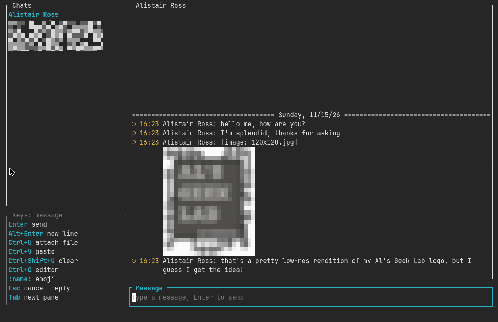

# gurk-rs - simplified 🥒
[Signal Messenger] client for terminal - lazy/easy version.

gurk is way cool, however I found the interface a little intimidating, so this fork seeks to make the TUI a bit more user-friendly.

It also includes ASCII representations of images straight into the message, which you can hit enter on to see them with your default image handler.

Navigation between each of the panels is via the tab key, e.g. type a message / message history / chat selector. There's also a handy context 

to talk to the original authors (I have no affiliation with these links): [![ci][ci-badge]][ci-link] [![chat][chat-badge]][chat-link] [![ko-fi][ko-fi-badge]][ko-fi-link]



# Installation

## Pre-compiled binary

Download a pre-compiled binary from [Releases].

Or, if you have [`cargo-binstall`](https://github.com/cargo-bins/cargo-binstall):

```shell
cargo binstall --git https://github.com/boxdot/gurk-rs gurk
```

## From source (using `cargo`)

Prerequisites:

* [`protoc`] compiler
* `perl`

```shell
cargo install --git https://github.com/boxdot/gurk-rs gurk
```

## Arch Linux

```shell
pacman -S gurk
```
(as root)
- Official repository, tagged releases: [`gurk`](https://archlinux.org/packages/extra/x86_64/gurk)
```shell
yay -S gurk
```
- AUR source build from Git HEAD: [`gurk-git`](https://aur.archlinux.org/packages/gurk-bin)

## Nix/NixOS

Either per user:

```
$ nix-env --install gurk-rs
```

or system-wide:

```nix
environment.systemPackages = with pkgs; [ gurk-rs ];
```

# Freebsd
#### (as root)
```shell
pkg install net-im/gurk-rs
```
- pkg repositories


```shell
cd /usr/ports/net-im/gurk-rs
make install clean
```
- ports tree
# Usage

Run

```
gurk
```

On the first run, it will open a QR code in your favorite image viewer, such that you can link the
client as a new device. This will also create a configuration file at the default [config
location][config-location]. For the configuration directives, see [`src/config.rs`].

Note: The binary cannot be published on crates.io, because it depends on several official Signal
libraries that are not available on crates.io.

## Chat

[][chat-link]

# Key bindings

The screen has three panes: **chats** (left), **messages** and the **message input**.
`Tab` / `Shift+Tab` moves between them; the focused pane has a thick cyan border. The
**Keys** box at the bottom left always lists what you can do right now, and `F1` shows
every shortcut.

## Default keybindings

* Everywhere
  * `Tab` / `Shift+Tab` Next / previous pane.
  * `Ctrl+N` New message to a contact or group.
  * `Ctrl+P` Jump to a chat by name.
  * `Ctrl+F` Find messages in the current chat.
  * `Ctrl+M` (or `Alt+M`) Mute / unmute the current chat.
  * `Ctrl+V` Paste text, or attach an image, from the clipboard.
  * `Alt+L` Hide / show the chats pane.
  * `F1` Help, `Ctrl+C` Quit.
* Chats pane
  * `Up/Down` or `j/k` Switch chat.
  * `Enter` Start typing in the selected chat.
* Messages pane
  * `Up/Down` or `j/k` Select a message.
  * `Enter` Open an image in the default viewer, save other attachments to
    `~/Downloads`, or open the first link.
  * `Ctrl+R` React: pick an emoji with the arrows or `hjkl`, `Enter` to react (again to
    remove). The last cell is a search box: type e.g. `shrug` to find 🤷.
  * `r` Reply, `e` Edit (own), `Ctrl+D` Delete (own), `y` Copy text.
  * `Ctrl+S` Save the attachments to a folder of your choice.
  * `Ctrl+U` Attach a file, `Ctrl+Shift+U` (or `Alt+U`) Clear the input.
  * `Esc` Back to the input.
* Message input (always multi-line)
  * `Enter` Send.
  * `Alt+Enter` (or `Shift+Enter`) New line.
  * `Ctrl+U` Attach a file using a file browser (remembers the last folder).
  * `Ctrl+Shift+U` (or `Alt+U`) Clear text, attachments and reply.
  * `Ctrl+O` Compose in your `$EDITOR`.
  * `:name:` Insert emoji, `Tab` completes a partial `:name`.
  * `Esc` Cancel reply / edit.
  * Cursor: `Left/Right`, `Ctrl/Alt+Left/Right` by word, `Home/End`, `Ctrl+W` delete word.

`Ctrl+M`, `Ctrl+Shift+U` and `Shift+Enter` need a terminal supporting the kitty keyboard
protocol (kitty, Ghostty, Alacritty, foot, WezTerm, ...). Elsewhere use `Alt+M`, `Alt+U`
and `Alt+Enter`.

Images are shown as colored previews in the messages pane.

## File Uploads
  * `Ctrl+U` opens a file browser (`Enter` to choose, `h` up a folder, `/` to filter, `.` hidden files).
  * Typing `file:///path/to/file` in a message still attaches that file.

## Configuration

### Command-line options

```
-c, --config <PATH>     Path to config file
    --data-dir <PATH>   Path to data directory
```

### Environment variables

| Variable | Description |
|----------|-------------|
| `GURK_CONFIG` | Path to config file (same as `--config`) |
| `GURK_DATA_DIR` | Path to data directory (same as `--data-dir`) |
| `XDG_CONFIG_HOME` | Base directory for config files (works on all platforms) |
| `XDG_DATA_HOME` | Base directory for data files (works on all platforms) |

### Config file locations

If no config path is specified, `gurk` searches these locations in order:

1. `$XDG_CONFIG_HOME/gurk/gurk.toml` (if `XDG_CONFIG_HOME` is set)
2. `$XDG_CONFIG_HOME/gurk.toml` (if `XDG_CONFIG_HOME` is set)
3. Platform config directory (e.g. `~/Library/Application Support` on macOS, `~/.config` on Linux)
4. `$HOME/.gurk.toml`

### Data directory

The data directory (for messages, Signal database, attachments) is determined by:

1. `--data-dir` CLI option or `GURK_DATA_DIR` env var
2. `data_dir` setting in config file
3. `$XDG_DATA_HOME/gurk` (if `XDG_DATA_HOME` is set)
4. Platform data directory (e.g. `~/Library/Application Support/gurk` on macOS)

## Custom keybindings
The default keybindings can be overwritten at startup by configuring
keybindings in `gurk.toml` using the format `keybindings.<mode>.<keycombination> =
"<command>"`. Valid modes are `anywhere` (always), `main` (all three panes),
`channels`, `messages`, `normal` (the message input), `channel_modal` and `help`. Valid key combination specifiers are e.g. `left,
alt-j, ctrl-f, backspace, pagedown`. The default keybindings can be disabled by
setting `default_keybindings = false`. An empty command removes an existing
binding if it exists in the given mode. Configuration troubleshooted by running
`RUST_LOG=gurk=trace,presage=trace,libsignal=trace gurk --verbose` and examining the resulting `gurk.log`.

### Supported commands
```
help
quit
toggle_channel_modal
toggle_multiline
react
scroll help up|down entry
move_text previous|next character|word|line
select_channel previous|next
select_channel_modal previous|next
select_message previous|next entry
kill_line
kill_whole_line
kill_backward_line
kill_word
copy_message selected
beginning_of_line
end_of_line
delete_character previous|next
edit_message
delete_message
open_url
open_file
toggle_mute_channel
toggle_channel_list
open_editor
redraw
new_line
focus_next
focus_previous
focus_input
react_picker
reply
open_message
save_attachment
attach_file
clear_input
search
new_message
paste
```

### Example configuration
```toml
default_keybindings = true

[keybindings.anywhere]
ctrl-c = ""
ctrl-q = "quit"

[keybindings.normal]
ctrl-j = ""
ctrl-k = "kill_line"
ctrl-n = "select_channel next"
ctrl-p = "select_channel previous"
alt-c = "toggle_channel_modal"
up = "select_message previous entry"
down = "select_message next entry"

[keybindings.channel_modal]
ctrl-j = ""
ctrl-k = ""
ctrl-n = "select_channel_modal next"
ctrl-p = "select_channel_modal previous"

[keybindings.messages]
alt-y = ""
alt-w = "copy_message selected"
ctrl-t = "react :thumbsup:"
ctrl-h = "react ❤️"
```

## License

 * GNU Affero General Public License v3 only ([AGPL-3.0-only](LICENSE-AGPL-3.0) or
   https://www.gnu.org/licenses/agpl-3.0.en.html)

### Contribution

Unless you explicitly state otherwise, any contribution intentionally submitted
for inclusion in this document by you, as defined in the AGPL-3.0-only license,
shall be licensed as above, without any additional terms or conditions.

[Signal Messenger]: https://signal.org
[`presage`]: https://github.com/whisperfish/presage
[`src/config.rs`]: https://github.com/boxdot/gurk-rs/blob/main/src/config.rs
[chat-badge]: https://img.shields.io/badge/chat-on%20signal-brightgreen?logo=signal
[ci-badge]: https://github.com/boxdot/gurk-rs/actions/workflows/ci.yaml/badge.svg
[ci-link]: https://github.com/boxdot/gurk-rs/actions/workflows/ci.yaml
[chat-link]: https://signal.group/#CjQKILaqQTWUZks14mPRSn0m0zyU9A-buNMG6haQBmWrxJHeEhCc7HLIwCFZRNDw63MWj-fA
[config-location]: https://docs.rs/dirs/3.0.2/dirs/fn.config_dir.html
[Releases]: https://github.com/boxdot/gurk-rs/releases
[`protoc`]: https://github.com/protocolbuffers/protobuf?tab=readme-ov-file#protobuf-compiler-installation
[ko-fi-badge]: https://img.shields.io/badge/Ko--fi-F16061?logo=ko-fi&logoColor=white
[ko-fi-link]: https://ko-fi.com/boxdot
